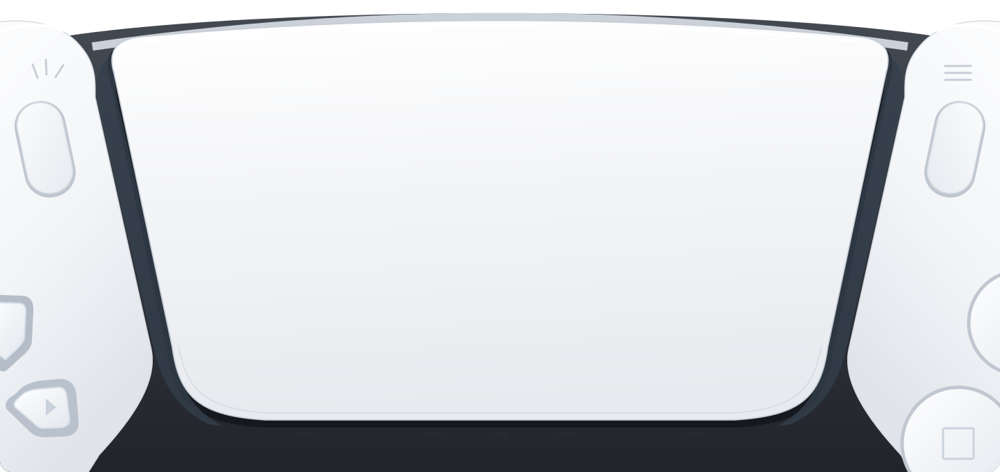

# Better controller experience for FFXIV — 使用指南

[快速开始](../README.zh-CN.md)

[English](USER-GUIDE.md) · [简体中文](USER-GUIDE.zh-CN.md) · [日本語](USER-GUIDE.ja.md)

用自定义 DualSense 灯光和振动，让手柄体验更爽。自己的技能、敌方音效和镜头震动都能带来更丰富的手感，同时保留游戏原生 DualSense 功能。插件基于 Dalamud 运行。

**Windows x64 · Dalamud API 15**

本指南提到的诊断页和诊断命令，需要显式使用 `-Development` 构建开发版，并通过 Dalamud 的开发插件流程加载。详见[开发构建](RELEASING.md#development-builds)。

[项目源码](https://github.com/Jackoltrade/Better-controller-experience-for-FFXIV) · [版本下载](https://github.com/Jackoltrade/Better-controller-experience-for-FFXIV/releases) · [提交问题](https://github.com/Jackoltrade/Better-controller-experience-for-FFXIV/issues) · [Ko-fi 支持](https://ko-fi.com/K7C122MEWU)



[安装](#安装) · [首次设置](#首次设置) · [灯光](#灯光) · [振动](#振动) · [聊天命令](#聊天命令) · [常见问题](#常见问题)

## 功能一览

- **RGB 灯带：** 常亮、彩虹、呼吸、双色渐变、极光、火焰、心跳、彗星、彩虹脉冲，以及两种音效响应模式。
- **下方 LED：** 设置触摸板下方五颗白灯的点亮数量和动画，也可以显示极限技状态。
- **战斗振动：** 玩家技能音效联动、Boss 技能、小怪技能和挨打时振动，都能分别开关。
- **方位与距离：** 以角色为中心，按镜头朝向区分左右；声音离角色越远，振动可以越弱。
- **画面特效：** 振动跟随镜头震动、放射模糊、方向模糊、高斯模糊和色差。
- **原生脚步增强：** 增强 USB DualSense 已有的脚步振动，不影响坐骑振动和扬声器音量。
- **实时预览与三语界面：** 边看预览边调灯光，用实时强度条调整音效响应，支持简体中文、英语和日语。

切出 FFXIV 时，插件会熄灭灯光并交还控制权，所有额外振动也会暂停。回到游戏或重新连接手柄，就会恢复保存的设置。设置保存在 Dalamud 中，不会写进手柄固件成为永久配置。

## 兼容性

| 手柄与连接方式 | 灯光 | 插件额外振动 |
| --- | --- | --- |
| 索尼 DualSense / DualSense Edge，USB | RGB 与下方 LED | 原生触觉反馈、战斗与画面特效振动、可选脚步增强 |
| 索尼 DualSense / DualSense Edge，蓝牙 | RGB 与下方 LED | 战斗与画面特效驱动的普通振动 |
| Xbox 兼容 XInput，USB 或无线 | 不控制灯光 | 战斗与画面特效驱动的普通振动 |

- 需要 Windows x64、FFXIV 和 **Dalamud API 15**。暂不支持其他操作系统，也不直接支持 DirectInput 力反馈。
- DualSense 触觉反馈、原生脚步与坐骑质感、手柄扬声器效果需要 **USB**。请在 FFXIV 中开启手柄振动，并按游戏原有方式配置 DualSense 功能。
- 蓝牙 DualSense 直接使用 HID 指令，无需映射软件、虚拟手柄驱动或配套应用；不提供蓝牙音频触觉流或手柄扬声器音频。
- XInput 会将额外振动与游戏原有的马达指令合并。仅支持 DirectInput 的设备需要 XInput 映射软件。本插件不负责按键映射或手柄配对。

本插件通过自定义仓库发布，尚未经过 Dalamud 官方主仓库审核。原生音频与镜头绑定曾在 XIVLauncherCN 的 `2026.10.06.0000.0000` 客户端上检查。开发环境的用户测试覆盖了 USB 原生功能，以及蓝牙灯光、振动、方位和距离；并不代表所有手柄型号、固件、地区客户端及后续补丁均已验证。[QA 报告](QA-REPORT.md)分别记录了自动检查、历次实机结果和待测项目。不兼容的原生布局会暂停相关功能，并在「诊断」中显示原因。

## 安装

所有界面语言共用下方这个仓库，也可以从[发布页](https://github.com/Jackoltrade/Better-controller-experience-for-FFXIV/releases)下载已发布的安装包。

### 通过 Dalamud 安装器安装

1. 打开 `/xlsettings` →「实验性」→「自定义插件仓库」。
2. 添加：
   ```text
   https://raw.githubusercontent.com/Jackoltrade/Better-controller-experience-for-FFXIV/main/repo.json
   ```
3. 在 `/xlplugins` 搜索 **Better controller experience for FFXIV**，点击「安装」。
4. 连接手柄，输入 `/bcef`。

安装时无需开启测试版本。仓库包含英文介绍和中文启动器使用的中文介绍，插件界面仍可独立切换中、英、日三种语言。已经添加过旧 release 仓库地址的用户可以继续使用原地址。

### 手动／开发插件安装

1. 版本发布后，从[发布页](https://github.com/Jackoltrade/Better-controller-experience-for-FFXIV/releases)下载 `latest.zip`；也可使用本地构建生成的 `artifacts/plugin/` 文件夹。
2. 将整个 ZIP 解压到独立文件夹。
3. 打开 `/xlsettings` →「实验性」→「开发插件位置」，添加该文件夹中的 `DualSenseLighting.dll`。
4. 在 `/xlplugins` → **Dev Tools** 中启用插件。

发布 ZIP 和 `artifacts/plugin/` 中都是普通构建；通过开发插件位置加载也不会启用「诊断」。需要记录时，请使用[单独的开发构建](RELEASING.md#development-builds)。

同一时间只保留一种安装方式。加载本插件前，请先停用旧版 **Steam Lighting Guard**；改用安装器时，移除开发插件条目。DLL 与内部标识仍为 `DualSenseLighting`，以保留已有设置和开发路径。停用或卸载时，使用原先加载插件的安装器即可。

## 首次设置

1. 想体验触觉反馈，就用 **USB** 连接 DualSense；想无线玩，就先在 Windows 中通过**蓝牙**配对，使用灯光和普通振动。XInput 手柄按平常方式连接。
2. USB DualSense 用户请先在 FFXIV 中开启手柄振动，确认想保留的游戏原生振动／扬声器功能正常。
3. 首次加载时，请阅读使用说明，选择是否开启灯光与振动。新安装默认均未勾选；已有安装会显示保存的选择，供你确认一次。点击**启用所选效果**或**暂不开启效果**完成设置。之后可点击左上角的**使用说明**或输入 `/bcef info` 再次查看。
4. 打开**振动 → 振动输出**。「自动」依次优先选择 USB DualSense 触觉反馈、DualSense 蓝牙普通振动、一个 XInput 手柄。多个手柄或映射软件并用时，可手动选择输出方式；XInput 可选择首个已连接手柄或编号 1–4。
5. 放几个技能试试，按手感调整**我的振动强度**与**敌方振动强度**。蓝牙／XInput 用户还可以调整下文的普通振动设置。
6. 切出游戏再返回，检查灯光交接；也可在游戏运行时拔插手柄，确认设置恢复且旧振动不会补播。

保存选择前，手柄输出、原生音效观察与额外振动均不会启动。关闭说明或选择**稍后再说**会保持暂停。说明中介绍了原生函数挂接、兼容性及本地处理方式。确认状态与「已查看说明」分开保存，重置标签页设置不会清除确认状态。

把鼠标放在选项或 **(?)** 上就能看说明，灰色选项也可以。关掉某个开关后，对应的下级设置会变灰，但数值都会保留。设置会自动保存；标签页上方的 **Language / 语言 / 言語** 可以随时切换语言，也会记住你的选择。

**恢复默认设置**会在确认后，仅重置当前的「灯光」或「振动」标签页。取消、关闭、Escape 或点击弹窗外均不会修改设置；另一个标签页和语言保持不变。更新会保留已有选择，新的默认值不会覆盖已明确保存的数值。

## 灯光

左右灯带始终使用同一种 RGB 颜色。手柄不支持单独控制每颗灯珠，所以做不出沿着灯带移动的波浪效果。

可以调整效果、亮度、颜色和循环时间。常亮只用一种颜色，双色渐变在两种颜色间切换，极光和火焰使用预设配色。RGB 和下方白灯各有自己的节奏；预览和实际手柄使用同一套灯光计算。

| 音效模式 | 效果 |
| --- | --- |
| 音量响应 | 音效越响，所选颜色越亮；安静时逐渐熄灭。 |
| 音效双色渐变 | 随音量从低音量颜色渐变到高音量颜色，安静时保留低音量颜色。 |

**仅自己的角色**跟随自己的动作和武器音效；**所有战斗音效**也包含附近玩家和敌人的声音。此选择只影响灯光，振动使用各自的分类开关。插件读取游戏音效，不采集麦克风或桌面音频。

放几个技能，看看**音效灵敏度**下方的强度条：经常满格就调低，声音小的技能几乎没反应就调高。**音效淡出时间**或**颜色恢复时间**决定响应回落的速度。**自动过滤微弱音效**会随灵敏度忽略过小的声音；可在**音效高级设置**中关闭自动模式并调整**手动过滤阈值**，调太高可能漏掉声音较小的技能。这些设置均不改变游戏音量。

**下方 LED**可选择关闭或点亮 1–5 颗，以及常亮、追逐、往返、闪烁、心跳、随机闪光、加载动画。追逐、闪烁和加载仅使用所选灯位；往返与随机闪光会使用全部五个灯位，数量决定同时点亮几颗；心跳让所选数量一起跳动。追逐至少选两颗才能看到移动，往返需少于五颗才有移动空间。

**极限技**模式在 PvE 显示队伍已蓄满的 LB 格数，在 PvP 显示自己极限技的充能，咏唱或使用自己的 LB 时快速闪烁。闪烁／加载周期与 RGB 分开设置；没有可用量谱或 LB 绑定不兼容时，可在「诊断」查看暂停原因。

## 振动

### 总开关与战斗分类

**启用振动**控制插件额外添加的全部振动，下方分为**战斗**、**画面特效**和**脚步振动增强**。关闭总开关会暂停三者，并保留设置。游戏原生振动、扬声器音频和扳机指令仍按游戏原有方式工作。

**启用战斗振动**统一控制**玩家技能音效联动**、**Boss 技能**、**小怪技能**和**挨打时振动**；关闭后，画面特效和脚步增强仍可独立使用。

| 战斗分类 | 响应内容 |
| --- | --- |
| 玩家技能音效联动 | 跟着自己的技能和武器音效振动，强度单独调整 |
| Boss 技能 | 副本 Boss 战中，已确认来源的 NPC 音效与符合条件的场地特效，包括普通攻击、施法和预警音效 |
| 小怪技能 | 跟着已确认的小怪技能效果振动，不包括普攻 |
| 挨打时振动 | 跟着自己受伤／格挡时的音效振动，普攻挨打也算，可单独开关 |

**敌方音效联动**分组包含**Boss 技能**、**小怪技能**和**挨打时振动**，共用**敌方振动强度**，可独立于**玩家技能音效联动**使用。已经带有游戏原生振动的声音不会重复添加。插件不改变可听见的音效、扬声器音量或自适应扳机。

**Boss 分类规则：**在任意人数的副本中，当你和已识别的 Boss 都处于战斗状态时，**Boss 技能**会使用覆盖更广的规则。音效必须有已确认的 NPC 来源，或来自符合条件的场地特效；未知来源、其他玩家、宠物及已确认属于玩家一方的 NPC 均不包含在内。音乐、对话、界面音和循环场地环境音均排除。此项并非「所有游戏声音」模式。

插件会记住**Boss 开战前**已明确识别为小怪的敌对 NPC，即使额外振动关闭也会记录。这些具体 NPC 在 Boss 战中仍使用小怪技能过滤。记录在战斗结束、切出游戏或切换功能后保留，区域／副本／玩家实体变化或重新加载插件时清空。Boss 战中首次出现的小怪可能归入 Boss 技能；中途重新加载也无法恢复此前记录。这个分组规则并不代表每个新 NPC 都已确认是 Boss 召唤物。

未进入上述副本 Boss 战状态时，仍使用已确认技能和关联机制的过滤规则。已识别的危命任务 Boss 及 B／A／S 级精英狩猎怪使用 Boss 技能，危命任务普通怪仍归小怪。Boss 识别复用 [LuminaSupplemental 数据](../data/README.md)和本地游戏元数据；未识别的 Boss 本身无法启用更广的规则。未知来源、播放布局或有歧义的技能音层仍可能不支持，测通一个机制不代表所有 Boss 均已覆盖。详见[敌方振动覆盖与限制](ENEMY-HAPTICS-COVERAGE.md)。

### USB、蓝牙与 XInput 输出

USB DualSense 通过游戏原生振动处理，把音效变成更细腻的手感。蓝牙／XInput 普通振动则在符合条件的战斗音效响起时给出短促冲击，避免长音效让手柄一直嗡嗡振。关闭灯光不影响振动。

在**振动输出 → 普通振动**中：

- **普通振动强度：**战斗普通振动的上限，默认 **50%**，「我的振动强度」「敌方振动强度」和距离衰减仍会叠加生效。画面特效使用独立强度。
- **单次振动时长：**默认 **120 毫秒**，范围 **60–300 毫秒**，时间越长，手感越厚重。
- **测试振动强弱：**按当前强度上限，先后播放较轻、较强的两次较长振动。
- **测试左右振动：**按当前强度和平衡设置，依次播放左侧、右侧振动。

测试时请站立不动。其他额外振动会短暂暂停，切出游戏会取消测试。USB 原生输出时不显示这些控件，包括已连接 USB 的自动模式。普通振动只选择一个输出手柄，灯光则可应用于多个已连接的 DualSense。

蓝牙会保留战斗方位设置的左右强度。左边偏厚重、低频，右边偏轻巧、高频，即使指令相同，手感也可能不同。**蓝牙振动左右平衡**默认为 **+85%**：左侧指令降至原来的 15%，右侧不变。正值减弱左侧，负值减弱右侧，0 为相同指令。设置在战斗与画面特效混合后生效，也适用于启用提示和测试。可按手感调整；这是用户选定的预设，并非自动校准，也无法让两边的手感完全一样。已保存的自定义值会保留。

支持的蓝牙固件会使用改良普通振动模式。诊断页显示当前模式、马达指令，并在测试结束后保留测试指令。XInput 使用不同频率马达的强度搭配，不提供精确左右定位，同时与游戏原有马达指令合并。使用映射软件生成的虚拟 Xbox 手柄时，可明确选择 XInput 输出；自动模式优先检测到的实体 DualSense。

### 共用方位与距离

**战斗振动高级设置**对自己的技能、Boss、小怪、挨打和场地音效都生效。即使关闭**玩家技能音效联动**，这些控件仍可调整。

**方位振动**以角色位置为中心，以镜头朝向区分左右，不受角色面向影响。**距离衰减**可独立于方位振动使用。推荐角色距离为 **3 米**内保持完整强度，逐渐衰减至 **25 米**处为零。开启衰减时，位置或参考信息缺失会暂停相关额外战斗反馈；游戏原生振动独立保留。

也可选择以**镜头**为距离起点。推荐范围会加上镜头到角色的距离，并随缩放调整。关闭**使用推荐衰减范围**即可手动设置，两种起点分别保存范围。以角色为起点时不受镜头缩放影响。

**我的音效设置 → 跟随技能命中方向**会将角色身边的武器／施法音层偏向自己技能最近可听见的命中位置，需要开启**玩家技能音效联动**与方位振动。**命中方向偏向程度**范围为 **25%–100%**，只改变方向，不改变音源距离。多个技能重叠时，方向只是近似参考。「诊断」的左右强度条展示计算结果，不是物理执行器测量值。

### 画面特效

画面反馈跟随实际镜头震动，以及已支持的模糊和色差效果，与其他振动同时播放并限制合成强度；已结束的效果不会补播。普通镜头移动、缩放、泛光和景深不会触发，黑洞扭曲尚未映射。

它有独立强度，默认 **25%**，不受战斗方位、距离和「我的振动强度」「敌方振动强度」影响。画面信号本身居中，蓝牙最终指令仍会应用左右平衡。USB DualSense 能表现更丰富的手感，普通振动则跟着特效强弱变化。PvP、区域切换、无角色或切至后台时暂停。详见[画面特效清单与时序限制](SCREEN-EFFECT-HAPTICS.md)，实际画面与手柄仍受硬件延迟影响。

### 原生脚步增强

仅放大游戏本来就有的脚步振动。开关和倍率需要 **USB 连接的 DualSense／Edge**，并选择**自动**或 **DualSense 触觉反馈**输出。蓝牙、XInput 或断开连接时，控件不可操作，但保留原有选择。

它受振动总开关控制，独立于战斗分组；骑乘或切至后台时暂停，支持 **100%–600%**，100% 为原生强度。不会放大坐骑振动、扬声器音量或战斗反馈。不同角色／种族的原生脚步振动强度可能不同，手感也会不一样；调倍率不会自动抹平这些差异。

### 默认设置

首次设置时，灯光和振动均未勾选。是否启用振动由你决定，即使总开关关闭，下表的分类预设也会保留。在「振动」标签页**恢复默认设置**，会恢复下表预设并开启振动总开关。更新时保留已有设置。

| 设置 | 默认值 |
| --- | --- |
| 启用振动 | 按首次设置中的选择；重置振动后开启 |
| 启用战斗振动 | 开启 |
| 输出方式 | 自动；需要 XInput 时选择首个已连接手柄 |
| 玩家技能音效联动 | 开启，强度 25% |
| Boss 技能／小怪技能 | 均开启，敌方强度 100% |
| 挨打时振动 | 关闭 |
| 画面特效 | 开启，强度 25% |
| 方位振动／距离衰减 | 均开启，角色起点，推荐 3–25 米 |
| 跟随技能命中方向 | 开启，偏向程度 100% |
| 战斗普通振动 | 强度 50%，单次 120 毫秒 |
| 蓝牙振动左右平衡 | +85% |
| 原生脚步增强 | 关闭，预存倍率 600% |

开启战斗振动时，手柄会短振两下提醒你，站着不动也能感觉到。调整强度或切回游戏不会重复振这两下。

## 聊天命令

`/bcef` 打开设置，`/bcef help` 查看命令，`/bcef info` 打开说明。只有通过 Dalamud 开发插件流程加载的开发构建，才能用 `/bcef trace` 开始或停止诊断记录并打开诊断页。已有宏请改用 `/bcef`。

使用 `/bcef <功能名> on`、`off` 或 `toggle`，例如 `/bcef combathaptics off`：

| 功能名 | 控制内容 |
| --- | --- |
| `lighting` | 自定义灯光 |
| `haptics` | 插件额外添加的全部振动 |
| `combathaptics` | 所有战斗分类 |
| `playersfx` | 自己的技能与武器音效振动 |
| `footsteps` | 原生脚步增强 |
| `spatialhaptics` | 战斗左右方位 |
| `distancefade` | 战斗距离衰减 |
| `followimpact` | 自己的技能命中方向引导 |

命令不区分大小写，会自动保存，可直接用于宏而不打开设置。上级关闭时，子项选择仍会保留，聊天栏会提示所需上级开关或 USB 条件。重复输入 `on` 不会重播启用提示。`footsteps off` 恢复原生强度，不会静音脚步振动。Boss／小怪／受击／画面开关和数值设置目前需在界面中调整。

## 诊断与隐私

「诊断」和 `/bcef trace` 需要显式使用 `-Development` 构建，并通过 Dalamud 开发插件流程加载 `artifacts/dev-plugin/` 中的开发版。发布 ZIP 和 `artifacts/plugin/` 中的普通 DLL 已移除诊断代码，即使通过开发插件流程加载也不会启用。详见[开发构建](RELEASING.md#development-builds)。

「诊断」提供手柄连接、前后台状态、输出选择与错误、马达测试结果、音效归属计数、计算后的左右强度及极限技状态。

首次请求记录时，会先显示**开始记录前**，说明采集内容、两处存储位置、文件保留与分享注意事项。点击**开始记录**才会保存确认并启动本次记录；取消、Escape 或点击弹窗外均不会启动。之后仍需手动开始记录，不会反复弹出说明。重置设置不会清除确认状态。

遇到该振不振，或者乱振的情况时：

1. 开启待测分类，关闭其他额外分类以便区分来源。
2. 在机制发生前输入 **`/bcef trace`**，或点击诊断页的**开始记录音效**。
3. 复现后再输入一次 **`/bcef trace`**，或点击**停止并保存记录**，注明技能名和大致发生时间。

记录持续到手动停止，按一分钟分段保存到 DLL 旁的 `sfx-traces/`，保留最新 **20** 段；`sfx-trace.json` 为最新保存的一段。镜头时序另存为 `%LOCALAPPDATA%\DualSenseLighting\screen-haptics-timing.json`，该目录下也有独立的 `sfx-traces/` 存档。

诊断页始终显示已保存记录的总占用与两处文件位置，未在记录时也可查看。停止记录并等待保存完成后，点击垃圾桶图标，再确认**删除记录**，即可删除音效与镜头时序记录的最新文件及历史存档。此操作无法撤销。

记录包含设置、音效／资源名称、NPC 与归属信息、位置、路由判断、本地进程地址及少量原生内存快照，**不会录制音频，也不会自动上传**。针对一个机制录一小段，更方便排查，长记录可能每分钟占用数十 MB。公开分享前请先检查内容。详见[镜头时序记录说明](SCREEN-EFFECT-HAPTICS.md#recording-timing-in-game)。

## 常见问题

| 现象 | 检查方法 |
| --- | --- |
| 开发插件图标一直不显示 | 输入 `/xldev`，打开 **Plugins → Clear cached images/icons**，再打开 `/xlplugins`。Dalamud 会缓存之前没找到图标的结果，单独重载插件不会清掉它。 |
| 未检测到手柄或无输出 | 先在 Windows 中连接或配对，检查诊断和输出方式。映射软件隐藏实体手柄可能影响检测；使用虚拟手柄时可明确选择 XInput。 |
| USB 原生振动正常，但战斗时没额外振动 | 开启总开关、战斗和所需分类，检查「我的振动强度」「敌方振动强度」，再查看诊断中的绑定、归属错误和距离截断。 |
| 蓝牙振动粗糙、太弱或左右不均 | 调整普通振动强度／时长，再分别运行两个测试，对照诊断保留的指令。按手感调整蓝牙左右平衡；两侧质感本来不同，画面强度需单独调整。 |
| 脚步设置变灰 | USB 连接 DualSense／Edge，选择自动或 DualSense 触觉反馈，并检查总开关。重连检测可能需要约一秒；游戏没有脚步振动信号时，增强功能不会凭空生成。 |
| 某个技能或 Boss 效果没反应 | 检查分类、音源位置与距离，以及游戏是否已提供原生振动。未知来源或布局仍可能跳过，可记录该机制协助排查；不承诺覆盖所有 Boss。 |
| Boss 预警音效也会振动 | 副本 Boss 战中的宽范围规则会有意包含来源明确的 NPC 施法与预警音效，并非仅命中时振动。 |
| 切出游戏后灯灭了 | 这是预期的交接。其他软件下次写入灯光时可重新应用设置，插件无法强制 Steam 恢复保存的颜色。 |
| 灯光闪烁或被覆盖 | Steam、DS4Windows 等软件可能同时写入。游戏前台时让一个工具负责灯光；USB 原生功能仍按 FFXIV 自身的 DualSense 设置启用。 |
| 下方白灯动画似乎不动 | 启用灯光、保持游戏在前台并选择非零数量。追逐至少需两颗，往返选择五颗时会铺满灯条。 |
| 游戏更新后功能失效 | 查看诊断、客户端地区／版本和 Dalamud API。原生绑定可能需要更新，仅 API 版本一致并不保证音频与镜头兼容。 |

## 反馈与支持

可以[在 GitHub 提交问题](https://github.com/Jackoltrade/Better-controller-experience-for-FFXIV/issues/new)，或[发送反馈邮件](mailto:jackzhou.work@protonmail.com?subject=%5BBetter%20controller%20experience%20for%20FFXIV%5D%20Feedback)。请提供插件版本、客户端版本与地区、Dalamud 版本、手柄型号与固件、USB／蓝牙／XInput 输出方式、设置和复现步骤，有需要时附上短记录。「关于」按钮只打开草稿或议题表单，由你自行提交。

插件完全免费，放心用。喜欢的话，可以[通过 Ko-fi 请我喝杯奶茶](https://ko-fi.com/K7C122MEWU)，或[在爱发电支持我](https://afdian.com/a/jackoltrade)。

## 从源码构建

准备 **.NET 10 SDK** 和兼容的 **Dalamud API 15** 库，在仓库根目录运行：

```powershell
./tools/build.ps1 -DalamudLibPath 'C:\path\to\Dalamud'
```

脚本可以自动发现本机 XIVLauncher／XIVLauncherCN 库，也支持 `DALAMUD_HOME`。WSL 会调用同一套 Windows SDK 构建流程；SDK 不在 Windows PATH 中时，可加 `--dotnet-path /mnt/c/path/to/sdk/dotnet.exe`：

```bash
python3 tools/build-wsl.py
```

脚本默认使用 `Dalamud.NET.Sdk/15.0.0` 生成优化的 x64 普通构建，运行手柄／核心逻辑／翻译检查，校验 DLL 标识、版本与 API，输出至 `artifacts/plugin/`。标准安装包位于 `artifacts/plugin/DualSenseLighting/latest.zip`，公开打包流程会补上安装器翻译和 README。加 `-LockedRestore`／`--locked-restore` 可校验仓库中的依赖锁定文件。`-Probe`／`--probe` 增加只读 USB／蓝牙能力检查，不发送手柄输出指令。

需要「诊断」时，请显式构建单独的开发版：

```powershell
./tools/build.ps1 -DalamudLibPath 'C:\path\to\Dalamud' -Development
```

通过开发插件位置加载 `artifacts/dev-plugin/DualSenseLighting.dll`。此优化构建包含诊断功能，不生成安装 ZIP。详见[开发构建](RELEASING.md#development-builds)。

CI 也会在 Windows PowerShell 5 中检查构建进程的参数传递和退出状态。可在本机运行同一组检查：

```powershell
powershell -NoProfile -ExecutionPolicy Bypass -File ./tests/BuildProcessChecks.ps1
```

```bash
python3 -m unittest discover -s tests -p 'test_*.py'
python3 tools/generate-enemy-bosses.py --check
python3 tools/package-release.py
```

`artifacts/release/` 中会生成 `latest.zip`、普通安装仓库 `pluginmaster.json`、校验和与发布摘要。包内含三语 README 与所需许可，不含用户配置、诊断记录、Dalamud 库和编译器依赖。本地打包不会发布任何内容。

[发布指南](RELEASING.md) · [QA 与证据](QA-REPORT.md) · [开发记录](DEVELOPMENT-NOTES.md) · [敌方覆盖](ENEMY-HAPTICS-COVERAGE.md) · [无主召唤物研究](OWNERLESS-SUMMON-INVESTIGATION.md) · [数据来源](../data/README.md) · [更新记录](../CHANGELOG.md)

## 许可与致谢

本项目采用 **GPL-3.0-only**，见 [LICENSE.txt](../LICENSE.txt)。手柄实现参考 [DS4Windows](https://github.com/hbashton/DS4Windows)，原生音频／镜头绑定参考 [FFXIVClientStructs](https://github.com/aers/FFXIVClientStructs)，Boss 查询数据来自 [LuminaSupplemental](https://github.com/Critical-Impact/LuminaSupplemental)。插件运行于 [Dalamud](https://github.com/goatcorp/Dalamud)。

完整来源与署名见 [THIRD-PARTY-NOTICES.txt](../THIRD-PARTY-NOTICES.txt)、[HidLibrary 许可](../LICENSE-HidLibrary.txt)、[FFXIVClientStructs 许可](../LICENSE-FFXIVClientStructs.txt)及[数据来源说明](../data/README.md)。无需安装音效模组，发布包也不包含音效模组资源。

本项目由社区独立开发，与索尼或 Square Enix 无隶属关系。
